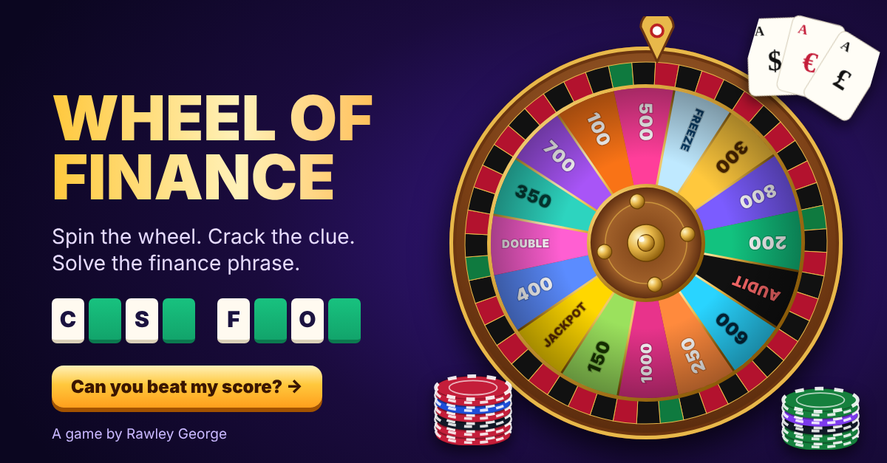

# 🎡 Wheel of Finance

**A game-show word game for finance people. Spin the wheel, crack the rhyming clue and solve the finance jargon before the Audit wipes your bank.**

▶ **Play it:** https://rawleygeorge-ui.github.io/wheel-of-finance/

## How to play

1. **Spin** the wheel, then call a **consonant**. Each time it appears on the board, you earn the value you landed on.
2. **Buy a vowel** for 250 when you need a nudge.
3. **Solve** at any time to bank your winnings, plus a 500 bonus.
4. Every puzzle is a piece of finance jargon with an everyday double meaning, hidden behind a **rhyming clue** that sounds totally unrelated. For example *"Kettle, heater, toaster too, now the whole house is dark for you (7, 7)"* is CIRCUIT BREAKER.

| Wheel space | What happens |
|---|---|
| 100 – 1000 | Earn that amount for every matching consonant |
| JACKPOT | 2,500 per letter |
| DOUBLE | A correct consonant doubles your bank |
| FREEZE | Account frozen: you take a strike |
| AUDIT | The auditors wipe your bank to zero |

Three strikes and the puzzle is lost. Five puzzles make up a game. After each puzzle, you see what the term actually means.

## About

Built by **[Rawley George](https://www.linkedin.com/in/rawley-george-884547272)**, a finance operations and automation professional.

The game is one HTML file with no dependencies and no tracking. Just a game, with no real money involved.

© 2026 Rawley George · Designed by rawsploit@gmail.com
